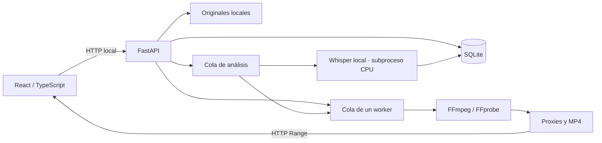

# Arquitectura de ClipZone Studio

## Responsabilidades

React mantiene el estado del editor y reproduce archivos servidos por FastAPI. La API valida las solicitudes con Pydantic, genera identificadores aleatorios para archivos y almacena metadatos en SQLite. Los servicios de medios y trabajos aíslan a FFmpeg del transporte HTTP. Un `ThreadPoolExecutor` con un worker procesa codificaciones fuera del hilo de solicitudes. No hay Redis, Docker ni servicios remotos obligatorios.

## Ciclo de importación

`POST /api/videos` recibe multipart, copia en bloques a `.part`, aplica el límite y valida con FFprobe. Solo publica la entrada en la biblioteca cuando la validación termina. Genera una miniatura opcional y almacena el original bajo un UUID. Archivos inválidos y subidas incompletas se limpian; los archivos externos del usuario no se alteran.

MP4/M4V H.264 con píxeles compatibles y AAC/MP3 puede reproducirse directamente. Otros formatos se convierten a un proxy H.264/AAC de hasta 1280×720 en la cola. Las exportaciones siempre leen el original. El proxy no reduce la calidad de los MP4 finales. La API sirve las vistas previas mediante `FileResponse`, con soporte para solicitudes parciales HTTP Range.

## Encuadre

Antes de escalar, FFmpeg normaliza los píxeles anamórficos a SAR 1:1. La autorrotación de FFmpeg se aplica al decodificar; los metadatos mostrados consideran la rotación. El modo `contain` escala manteniendo proporción y añade bandas negras centradas. `cover` aumenta la imagen conservando proporción y recorta según el foco X/Y. Los tamaños pares permiten codificar en `yuv420p`. El frontend usa `object-fit` y `object-position` para aproximar la composición; el reproductor del MP4 terminado muestra el resultado exacto.

La previsualización de edición depende de la decodificación del navegador y no simula cambios de códec, color ni audio. La precisión final del recorte se realiza con recodificación, en lugar de copiar segmentos limitados por keyframes. Las guías de subtítulos no son un filtro de render en esta fase.

## Ciclo de exportación

`POST /api/clips` comprueba el intervalo, el tamaño y la existencia del original. Devuelve HTTP 202 con el trabajo. La cola persiste `queued → running → completed/failed/cancelled`. Lee `out_time_us` del protocolo de progreso de FFmpeg y limita las escrituras a SQLite. Un archivo temporal para stderr evita bloquear el proceso si FFmpeg genera errores extensos.

La cancelación termina el proceso activo o impide iniciar un trabajo pendiente. Se eliminan resultados parciales. El cierre ordenado cancela la cola y espera al worker. Al reiniciar después de un cierre inesperado, los trabajos pendientes o activos anteriores se marcan como fallidos y se elimina su resultado parcial. Los completados se conservan. No se reanudan codificaciones parciales.

Máximo 20 trabajos pendientes de exportación. La cola es para una sola instancia de la aplicación: iniciar varios servidores contra el mismo `data` no está soportado.

## API

| Método | Ruta | Resultado |
|---|---|---|
| GET | `/api/health` | Dependencias, versión y capacidad IA |
| GET | `/api/videos` | Biblioteca |
| POST | `/api/videos` | Importa un archivo multipart |
| GET | `/api/videos/{id}/thumbnail` | Miniatura |
| GET | `/api/videos/{id}/preview` | Original compatible o proxy |
| POST | `/api/clips` | Encola un render |
| GET | `/api/ai/capabilities` | Dependencias y modelos locales disponibles |
| GET / POST | `/api/videos/{id}/analyses` | Historial / inicia análisis |
| GET | `/api/analyses/{id}` | Estado y progreso del análisis |
| GET | `/api/analyses/{id}/result` | Transcripción y momentos puntuados |
| POST | `/api/analyses/{id}/cancel` | Cancela el análisis |
| POST | `/api/clips/batch` | Genera los momentos seleccionados |
| GET | `/api/jobs` | Trabajos persistidos |
| GET | `/api/jobs/{id}` | Estado y progreso |
| POST | `/api/jobs/{id}/cancel` | Cancela el trabajo |
| GET | `/api/jobs/{id}/preview` | MP4 inline |
| GET | `/api/jobs/{id}/download` | MP4 como descarga |

La API no acepta rutas arbitrarias del cliente y no devuelve rutas internas. Los identificadores se resuelven desde SQLite. `GET /docs` muestra los esquemas de entrada completos.

## Análisis local de la fase 2

`AnalysisQueue` usa un executor independiente de un worker y subprocesos cancelables. Primero ejecuta FFmpeg para extraer PCM mono a 16 kHz y después `app.ai.worker`, que carga el modelo desde `models/whisper`. La extracción y la inferencia nunca se ejecutan en el hilo HTTP. Los modelos no se descargan desde los endpoints. `scripts/download_model.py` descarga solo Tiny/Base/Small desde el registro oficial de Whisper y comprueba el SHA256.

El worker mantiene en memoria un bloque de 60 s, además del modelo. Omite silencio digital y filtra segmentos con alta probabilidad de no contener voz y baja confianza. Añade el desplazamiento del bloque a cada marca temporal. Los límites de bloque pueden afectar una palabra o frase; la revisión en el editor permite corregirlos. El PCM temporal necesita aproximadamente 1,92 MB por minuto y se elimina tras éxito, fallo o cancelación. El proceso padre gestiona FFmpeg y Whisper por separado para poder terminar el proceso activo sin dejar un decodificador huérfano.

La tabla `analyses` se crea automáticamente al abrir una biblioteca existente, sin borrar ni migrar destructivamente datos. Cada análisis persiste opciones, estado y, al completarse, transcripción y momentos. Los endpoints de estado omiten el resultado grande; solo `/result` devuelve las palabras y propuestas. El historial conserva resultados anteriores. Los análisis interrumpidos se marcan como fallidos en el siguiente arranque y sus temporales se limpian. La reutilización exige coincidencia de vídeo, modelo e idioma.

`detect_moments` agrupa palabras por puntuación y pausas; considera ventanas de duración configurable y las ordena por cobertura de voz, ritmo, señales léxicas de gancho, cierre y energía relativa. Suprime intervalos cuyo solapamiento supera el 35 % del fragmento menor. Cada tarjeta incluye razón y métricas. Es un ranking heurístico sobre una transcripción generada por IA, no una evaluación semántica con LLM ni una predicción de éxito.

La generación múltiple solo acepta IDs de momentos pertenecientes a un análisis completo; no admite rutas o intervalos arbitrarios desde el lote. Valida todas las selecciones, el original y la capacidad de 20 trabajos antes de encolar. Un lock compartido con la exportación manual evita que dos lotes consuman la misma capacidad al mismo tiempo. Los ajustes de cada exportación incluyen análisis, momento y puntuación de origen. Los cuatro destinos son `tiktok`, `reels`, `shorts` y `facebook`, con `custom` adicional.

La fase 3 añadirá estilos y generación de ASS/SRT a partir de palabras; la fase 4 calculará posiciones de recorte en el tiempo. Los subtítulos dinámicos y el seguimiento de sujetos siguen pendientes.
