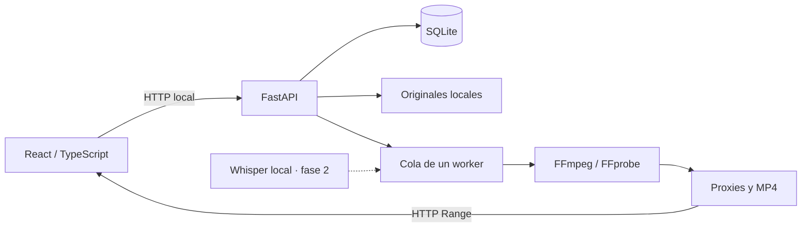

# Arquitectura de ClipZone Studio

## Responsabilidades

React mantiene el estado del editor y reproduce archivos servidos por FastAPI. La API valida las solicitudes con Pydantic, genera identificadores aleatorios para archivos y almacena metadatos en SQLite. Los servicios de medios y trabajos aíslan a FFmpeg del transporte HTTP. Un `ThreadPoolExecutor` con un worker procesa codificaciones fuera del hilo de solicitudes. No hay Redis, Docker ni servicios remotos obligatorios.

## Ciclo de importación

`POST /api/videos` recibe multipart, copia en bloques a `.part`, aplica el límite y valida con FFprobe. Solo publica la entrada en la biblioteca cuando la validación termina. Genera una miniatura opcional y almacena el original bajo un UUID. Archivos inválidos y subidas incompletas se limpian; los archivos externos del usuario no se alteran.

MP4/M4V H.264 con píxeles compatibles y AAC/MP3 puede reproducirse directamente. Otros formatos se convierten a un proxy H.264/AAC de hasta 1280×720 en la cola. Las exportaciones siempre leen el original. El proxy no reduce la calidad de los MP4 finales. La API sirve las vistas previas mediante `FileResponse`, con soporte para solicitudes parciales HTTP Range.

## Encuadre

Antes de escalar, FFmpeg normaliza los píxeles anamórficos a SAR 1:1. La autorrotación de FFmpeg se aplica al decodificar; los metadatos mostrados consideran la rotación. El modo `contain` escala manteniendo proporción y añade bandas negras centradas. `cover` aumenta la imagen conservando proporción y recorta según el foco X/Y. Los tamaños pares permiten codificar en `yuv420p`. El frontend usa `object-fit` y `object-position` para aproximar la composición; el reproductor del MP4 terminado muestra el resultado exacto.

La previsualización de edición depende de la decodificación del navegador y no simula cambios de códec, color ni audio. La precisión final del recorte se realiza con recodificación, en lugar de copiar segmentos limitados por keyframes. Las guías de subtítulos no son un filtro de render en esta fase.

## Ciclo de exportación

`POST /api/clips` comprueba el intervalo, el tamaño y la existencia del original. Devuelve HTTP 202 con el trabajo. La cola persiste `queued → running → completed/failed/cancelled`. Lee `out_time_us` del protocolo de progreso de FFmpeg y limita las escrituras a SQLite. Un archivo temporal para stderr evita bloquear el proceso si FFmpeg genera errores extensos.

La cancelación termina el proceso activo o impide iniciar un trabajo pendiente. Se eliminan resultados parciales. El cierre ordenado cancela la cola y espera al worker. Al reiniciar después de un cierre inesperado, los trabajos pendientes o activos anteriores se marcan como fallidos y se elimina su resultado parcial. Los completados se conservan. No se reanudan codificaciones parciales.

Máximo 20 trabajos pendientes de exportación. La cola es para una sola instancia de la aplicación: iniciar varios servidores contra el mismo `data` no está soportado.

## API

| Método | Ruta | Resultado |
|---|---|---|
| GET | `/api/health` | Dependencias, versión y capacidad IA |
| GET | `/api/videos` | Biblioteca |
| POST | `/api/videos` | Importa un archivo multipart |
| GET | `/api/videos/{id}/thumbnail` | Miniatura |
| GET | `/api/videos/{id}/preview` | Original compatible o proxy |
| POST | `/api/clips` | Encola un render |
| GET | `/api/jobs` | Trabajos persistidos |
| GET | `/api/jobs/{id}` | Estado y progreso |
| POST | `/api/jobs/{id}/cancel` | Cancela el trabajo |
| GET | `/api/jobs/{id}/preview` | MP4 inline |
| GET | `/api/jobs/{id}/download` | MP4 como descarga |

La API no acepta rutas arbitrarias del cliente y no devuelve rutas internas. Los identificadores se resuelven desde SQLite. `GET /docs` muestra los esquemas de entrada completos.

## Extensión hacia IA

`Transcriber` devuelve palabras con marcas de tiempo. `WhisperLocal` implementa el contrato usando un `.pt` local y `word_timestamps=True`; no descarga pesos implícitamente. `MomentDetector` describe el contrato de puntuación de intervalos, todavía sin implementación. En la fase 2 se añadirán tareas de transcripción, estados persistidos, cancelación y selección revisable. La exportación existente podrá recibir los intervalos sugeridos sin sustituir el servicio FFmpeg.

La fase 3 añadirá un modelo de estilos y generación de ASS/SRT a partir de palabras; un filtro de subtítulos se incorporará al servicio de medios. La fase 4 calculará posiciones de recorte a lo largo del tiempo. Esos módulos no están conectados al MVP ni se anuncian como funciones disponibles.
